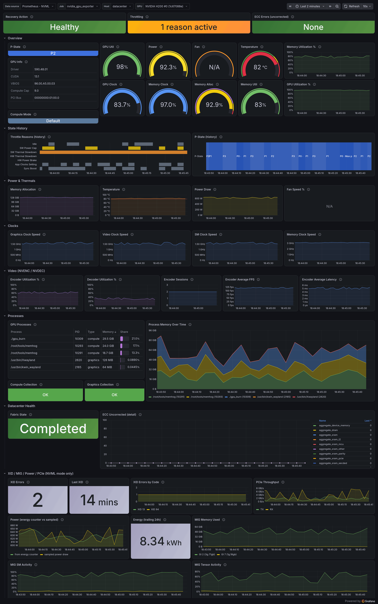
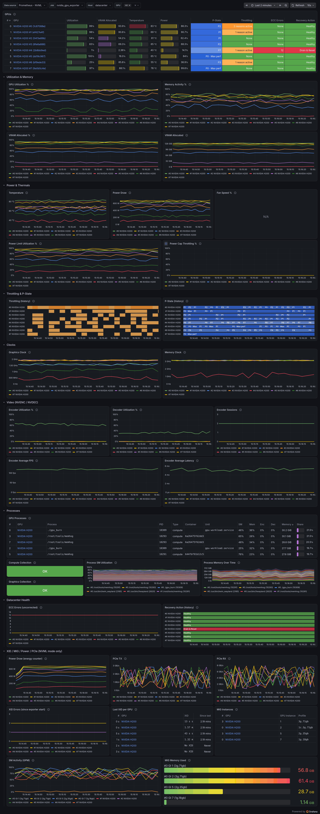

# nvidia_gpu_exporter

[](https://github.com/utkuozdemir/nvidia_gpu_exporter/actions/workflows/build.yml)
[](https://codecov.io/gh/utkuozdemir/nvidia_gpu_exporter)
[](https://scorecard.dev/viewer/?uri=github.com/utkuozdemir/nvidia_gpu_exporter)
[](https://github.com/utkuozdemir/nvidia_gpu_exporter/releases)
[](https://github.com/utkuozdemir/nvidia_gpu_exporter/blob/main/LICENSE)
[](https://www.bestpractices.dev/projects/14375)

[](https://github.com/utkuozdemir/nvidia_gpu_exporter/releases)
[](https://hub.docker.com/r/utkuozdemir/nvidia_gpu_exporter)
[](https://grafana.com/grafana/dashboards/14574)
[](https://grafana.com/grafana/dashboards/25547)
[](https://artifacthub.io/packages/helm/nvidia-gpu-exporter/nvidia-gpu-exporter)
[](docs/INSTALL.md#winget)

Prometheus exporter for NVIDIA GPUs, reading metrics directly from the NVIDIA driver library (NVML) or through `nvidia-smi`.
Runs on Linux, Windows and macOS, on bare metal, in Docker or on Kubernetes.

---

> [!WARNING]
> Heads up: this is a side project I maintain in my spare time. I might take a long time to look at issues or PRs, or not get to them at all. Sorry in advance, and thanks for understanding.

---

## Overview

The exporter collects utilization, memory, power, thermals, clocks, throttling reasons, ECC errors, encoder/decoder stats and per-process GPU usage, and exposes them as `nvidia_smi_*` Prometheus metrics.

It supports two collection backends that share the same metric schema (metric names, base units, label sets and enum mappings) across every shared field (see [CONFIGURE.md](docs/CONFIGURE.md#native-nvml-backend)):

- **Native NVML (`nvml`, recommended)**: reads `libnvidia-ml.so.1` on Linux and `nvml.dll` on Windows in-process without spawning `nvidia-smi`. In addition to the shared metrics, it exports families only the driver library provides: XID error counters, total energy consumed, per-MIG-instance metrics, whole-GPU GPM activity ratios, PCIe throughput and replay counters, NVLink byte counters, graphics processes and per-process engine utilization. On Linux it ships in the `-nvml` container images (`:X.Y.Z-nvml`) and `nvidia_gpu_exporter-nvml_*` archives with `nvml` enabled by default. On Windows it is included in `nvidia_gpu_exporter.exe` and enabled with `--collect.backend=nvml`.
- **`nvidia-smi` subprocess (`exec`)**: runs `nvidia-smi` and parses its CSV output. It remains the compiled default in the plain (non-`-nvml`) images, archives, `deb`/`rpm` packages, and Windows binary for 1.x compatibility, works as a static binary with zero C bindings on any platform where `nvidia-smi` exists, isolates the exporter from stuck driver calls, auto-discovers brand-new driver fields, and supports custom wrapper commands (`ssh`, `sudo`).

## Quick start

On a Linux machine with the NVIDIA driver and the NVIDIA Container Toolkit (using the `-nvml` image flavor):

```bash
docker run -d --name nvidia_gpu_exporter --restart unless-stopped \
  --gpus all -e NVIDIA_DRIVER_CAPABILITIES=utility -p 9835:9835 \
  utkuozdemir/nvidia_gpu_exporter:latest-nvml
curl http://localhost:9835/metrics
```

Use `utkuozdemir/nvidia_gpu_exporter:latest` instead if you prefer the static `nvidia-smi` subprocess backend.

No GPU at hand? `nvidia_gpu_exporter --collect.backend demo` serves realistic synthetic metrics on any machine. For Windows, macOS, packages, Kubernetes and running without Docker, see [INSTALL.md](docs/INSTALL.md).

## Use cases

- Consumer and prosumer GPUs (GeForce/RTX), workstations and gaming rigs, where datacenter fleet tooling exposes little or does not run
- Small Kubernetes clusters, edge boxes and homelabs that want GPU metrics, alerts and dashboards without installing the NVIDIA GPU Operator stack
- Virtualized or restricted setups (vGPU guests, MIG slices, locked-down containers, WSL2)
- Mixed fleets of old and new cards across Linux and Windows that need one exporter with a uniform metric schema
- Remote monitoring of another host over an `ssh` wrapper command (`exec` backend)

If you run a large datacenter fleet on Kubernetes with the GPU Operator already installed, [DCGM-exporter](https://github.com/NVIDIA/dcgm-exporter) is probably the better fit.

## Demo mode

Demo mode serves realistic synthetic metrics covering the full NVML surface, with no GPU, driver or Linux required:

```bash
nvidia_gpu_exporter --collect.backend demo
```

By default it simulates two H200 GPUs with fluctuating values, a MIG topology and an XID error history. The simulated setup is configurable, see [CONFIGURE.md](docs/CONFIGURE.md#demo-mode).

## Visualization

There are two official Grafana dashboards, and they link to each other in Grafana:

- [Nvidia GPU Metrics](https://grafana.com/grafana/dashboards/14574) (ID `14574`), the per-GPU detail view.
- [Nvidia GPU Overview](https://grafana.com/grafana/dashboards/25547) (ID `25547`), which compares all GPUs of a node side by side and drills down into the detail dashboard.

Import either by ID in Grafana (*Dashboards* - *New* - *Import*), or enable `grafanaDashboard` in the Helm chart to get both provisioned automatically. The JSON files also live under [docs/grafana](docs/grafana).





## Installation

[INSTALL.md](docs/INSTALL.md) covers every platform:

- **Linux**: `deb`/`rpm` packages, static or `-nvml` binaries, and a systemd unit
- **Docker**: `:X.Y.Z-nvml` and `:X.Y.Z` container images on [Docker Hub](https://hub.docker.com/r/utkuozdemir/nvidia_gpu_exporter) and [GHCR](https://github.com/utkuozdemir/nvidia_gpu_exporter/pkgs/container/nvidia_gpu_exporter)
- **Kubernetes**: the [Helm chart](charts/nvidia-gpu-exporter) on [Artifact Hub](https://artifacthub.io/packages/helm/nvidia-gpu-exporter/nvidia-gpu-exporter) (including Prometheus alert rules and Grafana dashboards) or a plain DaemonSet
- **Windows**: `winget`, Scoop, a native Windows service, or an all-in-one PowerShell script that also sets up Prometheus and Grafana
- **macOS**: binary archive for remote scraping over SSH

Release artifacts, container images, and Helm charts are signed and carry GitHub build provenance attestations. See [INSTALL.md](docs/INSTALL.md#verifying-what-you-downloaded) for verification commands and [SECURITY_MODEL.md](docs/SECURITY_MODEL.md) for the security model.

## Configuration and metrics

- [CONFIGURE.md](docs/CONFIGURE.md): flags, collection backends, per-process metrics, background collection, timeouts and `/-/gpu-healthy`.
- [METRICS.md](docs/METRICS.md): metric families, labels, enum mappings, MIG and XID semantics, and Kubernetes / `vLLM` PromQL joins.

## Contributing

See [CONTRIBUTING.md](.github/CONTRIBUTING.md) for the development setup, [ROADMAP.md](docs/ROADMAP.md) for what is planned, and [GOVERNANCE.md](.github/GOVERNANCE.md) for how decisions are made.

### Contribute a GPU capture

The test suite replays recorded `nvidia-smi` output and NVML symbol lists from real hardware across GPU models, driver versions and operating systems. Recording a capture from a GPU or driver version not yet in the corpus takes one command:

```bash
./internal/captures/collect.sh          # add --load for an under-load sample too
```

It runs read-only, masks identifiers (GPU UUID, serial, hostname) by default, and writes one `.txt` file. Commit it and open a PR, or attach it to an issue. See [internal/captures/README.md](internal/captures/README.md).

## Star History

<!-- markdownlint-disable no-inline-html -->
<a href="https://github.com/utkuozdemir/nvidia_gpu_exporter/stargazers">
  <picture>
    <source media="(prefers-color-scheme: dark)" srcset="https://raw.githubusercontent.com/utkuozdemir/star-charts/main/charts/utkuozdemir/nvidia_gpu_exporter/dark.svg" />
    
  </picture>
</a>
<!-- markdownlint-enable no-inline-html -->
